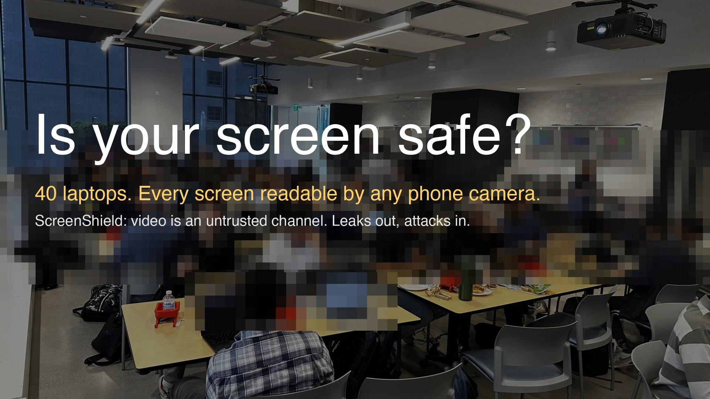
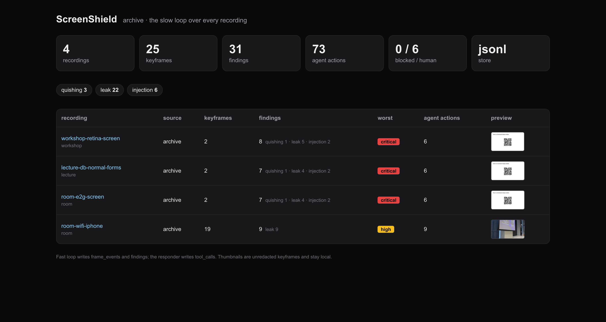

# ScreenShield — DLP for video. Video is an untrusted channel.

Cyberdefense Hackathon, SF Tech Week, 9 Oct 2026 (tokens& · AWS Builder Loft). Tracks: threat discovery + continuous defense.

[](https://youtu.be/8p0dc0lLVjM)

**Demo video (94 s):** https://youtu.be/8p0dc0lLVjM

**Are you safe?** Forty laptops in this room, every screen readable by any phone camera: repos, `.env` files,
dashboards, chats. One camera on a tripod and the whole room's secrets are on a recording. ScreenShield is what
should sit between that camera and the recording.

Every lecture hall, boardroom and webinar records a screen. Screens show API keys, passwords, grades and e-mails
(**leaks out**). The same frames carry QR codes aimed at viewers and instruction text aimed at the AI agents that now
watch camera feeds through MCP (**attacks in**). ScreenShield watches the stream, live and across the archive, and acts.

```
stream (screen · camera · SRT/RTMP) ─► keyframes ─► OCR + QR (Apple Vision, on-device)
      ─► detectors: leaks · quishing · injection      (deterministic, outside the model)
      ─► guard: taint · approved destination · isolator (DRIFT-style gates for any agent watching the feed)
      ─► store: ClickHouse (fleet events, findings, tool calls) or JSONL
      ─► responder agent (open model on AkashML): redact · revoke · block · notify · retention · incident
```

## Two loops, two speeds

- **Fast loop, on the device, no LLM** (`shield live`): keyframes → OCR/QR → deterministic detectors → gates →
  blur → events. Sub-second, works offline. This is the protection module.
- **Slow loop, the agent, over the archive** (`shield audit`): crawls the recording library, calls a vision model
  only where regexes are blind, verifies and decides per policy, cleans old recordings (redact / retention / hold),
  writes the evidence log, and **produces the dataset the fast loop learns from** (`dataset/`: labelled keyframes
  and expectations that feed `shield eval`). Batch, autonomous, cheap to run nightly. `shield review` then goes
  back over stored findings: a vision model confirms or rejects each one (false-positive filter) and OCR on the
  redacted recording proves the blur actually removed the text. Verified live on AkashML (Qwen3.6-35B-A3B vision,
  thinking off): 3/3 confirmed and 3/3 blur-verified on the camera recording; 30 confirmed, 1 rejected across the archive.

## What the agent does with a burned credential

A key that was visible on a recorded screen is burned. The responder (slow loop, sgr-agent on AkashML, policy decides, not the model) calls `rotate_in_repo`: every occurrence of that rule under the configured repo scope is replaced with a placeholder in the same format, the burned values are listed in `COMPROMISED.md`, and the change is committed on a separate branch `screenshield/incident-<ts>` through a git worktree, then pushed with a pull request. Main and the developer's checkout are never touched. Example from the live demo: [PR #1](https://github.com/fortunto2/screenshield/pull/1). The old value still has to be revoked at the provider; that step is logged as `revoke_credential` (dry-run).

Scope is set by `SHIELD_REPO`; without it the tool is blocked.

## One binary (Rust) and a reference implementation (Python)

`shield-rs/` is the product: one static binary `shield` built on fortunto2 crates (sgr-agent for the responder's
tool calling, openai-oxide underneath, va-scene/va-features next). `screenshield/` (Python) is the reference
implementation and test oracle; both read the same fixtures and produce the same findings.

```bash
cd shield-rs && cargo build --release          # → target/release/shield
shield scan fixtures/lecture-7s.mp4             # findings, 2 keyframes, < 1 s
shield scan screen --record -v                  # fast loop on your screen, parallel recording
shield scan "cam:MacBook Pro Camera" --limit 5  # any avfoundation device by name
shield redact in.mp4 findings.jsonl out.mp4     # blur every finding box
shield respond findings.jsonl                   # responder agent: sgr-agent tool calling on AkashML (openai/gpt-oss-120b),
                                                #   any OpenAI-compatible endpoint works; rule-based planner offline
shield audit ./recordings                       # slow loop → dataset/ + report.json
shield review --work .shield                    # the agent re-checks findings: vision confirm/reject, blur verified by OCR
shield eval fixtures                            # catch rate over fixtures
```

## Archive dashboard (Next.js)

`dashboard/` shows what the slow loop produced: every recording with its keyframes, findings by kind, worst
severity and responder actions; a recording page with a findings timeline, the keyframes and the agent's
tool calls. Reads the same three tables from JSONL (`SHIELD_WORK`, default `../.shield-archive`) or from
ClickHouse when `CLICKHOUSE_HOST` is set.

**ClickHouse, measured locally (single `clickhouse server` binary, M-series Mac):** 6.0M keyframe rows ingested at
~115k rows/s; the three fleet queries (secret held on screen, QR campaign across rooms, frame text → tool call join)
answer in 26–34 ms each over HTTP; `ocr_text ILIKE` grep across the 6M-row fleet in 34 ms. Flagged keyframes are
stored in `findings.evidence_jpeg` (640px JPEG, base64) so an incident carries its own evidence; ordinary keyframes
stay as OCR text + hashes.

```bash
shield audit ./archive --work .shield-archive     # produce the data
cd dashboard && pnpm install && pnpm dev            # http://localhost:3000
```



## Code on stream

Code is shown on purpose, so `source-code` and `repo-hint` are **watch** findings: logged, never blurred. Only
credential lines inside the code are blurred (the secret rules work per OCR line). `shield review` then reads the
OCR'd code as data and says whether it is safe to stream: language, repository, hardcoded secret, injection,
unsafe call. Fixture: `fixtures/code-on-screen.png`.

## Try it (Python reference, macOS, 2 minutes)

```bash
make vision                       # builds bin/visionscan (Swift, Apple Vision OCR + barcode)
uv sync
uv run shield eval                # OCR + detectors over fixtures/, catch rate
uv run shield scan fixtures/lecture-7s.mp4     # findings as JSON lines
uv run shield live screen --limit 20 -v        # watch your own screen, record, store
uv run shield respond .shield/findings.jsonl   # the agent decides what to do (dry-run)
uv run shield audit ./recordings               # slow loop over an archive → dataset/ + report.json
uv run shield dashboard                        # http://127.0.0.1:8787
uv run shield ingest-synth --rooms 10000       # fleet-scale telemetry into ClickHouse
```

Set `CLICKHOUSE_HOST/USER/PASSWORD`, `AKASHML_API_KEY`, `SENSO_API_KEY` in `.env` to switch from local fallbacks.

## What the agent knows before it writes

- **Policy** (Senso, verified org context; `policy.json` offline): allowed QR domains, approved stream destinations,
  what counts as sensitive here. The frame can never change it.
- **Fleet facts** (ClickHouse): is this the first room showing this QR, or the 31st in 20 minutes?
- **Boundaries**: anything that would drop a live stream goes to a human first. Destinations are allowlisted.
  Text from frames is tainted: a tool argument that appeared on screen seconds earlier is blocked.

## Sponsor tools

| Tool | Where |
|---|---|
| ClickHouse | `frame_events` (one row per keyframe across the fleet), `findings`, `tool_calls`; the three fleet queries on the dashboard |
| Semgrep | Guardian on this repo while it was written; secrets patterns mirrored in `detectors.py` |
| AkashML | responder agent (openai/gpt-oss-120b via sgr-agent tool calling) and vision review (Qwen3.6-35B-A3B); both verified live |
| Senso | the org policy document the agent reads before acting |
| Guild | hosts and traces the responder |

## Why nobody fixed it

The leak is the presenter's mistake, so nobody reports it to the capture vendor and no vendor sells a fix. Yet
compliance guides list "screen-sharing with a gradebook tab open" as a FERPA violation, and a recording in which a
student is identifiable is part of their education record. On the attack side, 67% of people in a field study were
willing to sign in through a malicious QR code, and only 8% abandon a suspicious link after seeing its preview.
A device that catches what the presenter missed, and keeps the evidence log, turns "we think nothing leaked" into
"here is the record".

## Background

Chaowei Xiao (JHU / NVIDIA) at "Rethinking Agents", Stanford, 8 Oct 2026: once a device opens to third-party AI,
the video itself is an attack surface. Gates in this repo follow DRIFT (Li, Xiao et al., NeurIPS 2025): control
constraints, data provenance, injection isolation. Visual prompt injection against computer-use agents reaches
100% success in VPI-Bench (ICLR 2026); the gate therefore sits outside the model.

**Why this problem:** the author works on AI at Epiphan, whose Pearl-class lecture-capture encoders sit in thousands
of classrooms and push SRT/RTMP streams; once such devices open to AI agents, the video itself becomes an attack
surface (Mike Sandler, Epiphan). ScreenShield takes exactly that stream shape as input. No Epiphan code or data is
used here; this is a personal hackathon project.

MIT. Built with Claude Code during the event.
